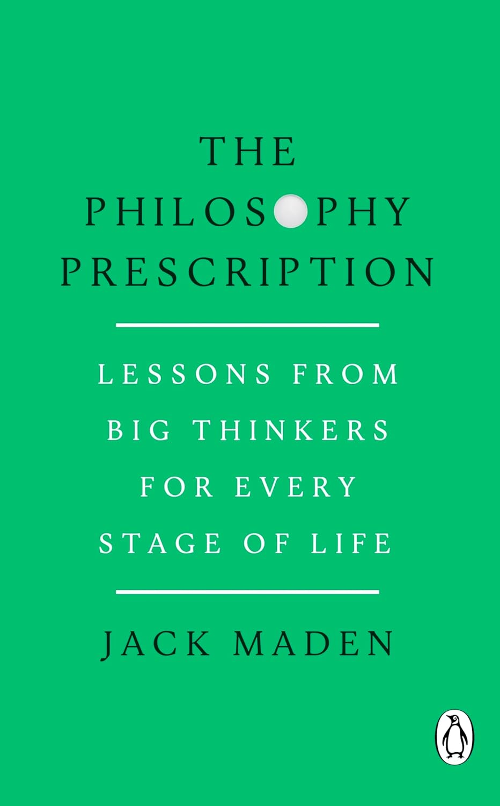

<svg xmlns="http://www.w3.org/2000/svg" viewBox="0 0 512 512"><path d="M464 448H48c-26.51 0-48-21.49-48-48V112c0-26.51 21.49-48 48-48h416c26.51 0 48 21.49 48 48v288c0 26.51-21.49 48-48 48zM112 120c-30.928 0-56 25.072-56 56s25.072 56 56 56 56-25.072 56-56-25.072-56-56-56zM64 384h384V272l-87.515-87.515c-4.686-4.686-12.284-4.686-16.971 0L208 320l-55.515-55.515c-4.686-4.686-12.284-4.686-16.971 0L64 336v48z"/></svg>&nbsp;&nbsp;Moonrise over the Sea, by Caspar David Friedrich (1822), <a target="_blank" rel="noopener noreferrer" href="https://commons.wikimedia.org/wiki/File:Caspar_David_Friedrich_-_Moonrise_by_the_Sea_-_WGA08266.jpg">via Wikimedia Commons</a>

<i>My Dutch publisher, [Ten Have](https://www.uitgeverijtenhave.nl/boek/denkpauze/), recently interviewed me about the Dutch translation of my book, [The Philosophy Prescription](/the-philosophy-prescription/). I thought I’d share the English version of the interview with you here. I hope you enjoy it!</i>

\-

## What inspired you to write this book?

Philosophy is too often regarded as a dead subject dominated by dead white men who have nothing of import or relevance to say about our lives.

As someone who actively chose to start studying philosophy at university a couple of decades ago, I am well versed in having to defend it from such slander.

I soon realised the rot ran far deeper than my friends and family, however: it seems the majority of society has its suspicions. Philosophy tends to be seen as some lofty, pointless, even privileged pastime.

This false impression prevents people from discovering how, actually, philosophy might help articulate and address some of their deepest concerns. 

If we’re filled with anxiety about the past or the future, for instance, if we don’t know what to do with our lives, if we feel uncertain in our relationships, if we worry about how much we need to earn to live well, if meaning seems to be eroding from our days, if we are terrified of death and yearn for something more: all of this noise in our minds is underpinned by fundamental philosophical questions.

Who am I? What should I do? Why should I go on?

These questions may feel intensely personal, but we don’t have to face them alone. Our most secret longings and fears can actually end up being what connect us to every other human who’s ever been alive. My book is inspired by a wish to demonstrate this: that philosophy is for, and can genuinely benefit, all of us.

In the book, I distill ideas from different thinkers across sixteen common stages or challenges of life. Some of the thinkers are ancient, some contemporary; some are famous, some lesser-known – and, deviating from the old dead white man presentation of philosophy, the book contains many living women.

The idea is to present some of the most enlightening, insightful, and provocative perspectives philosophers have had on questions we all face: from childhood, friendship, love, and making hard decisions, to work, money, grief, illness, and facing impermanence.

Each chapter begins by introducing a particular challenge, be it a midlife crisis or deciding whether to have children. We then hear what three or four philosophers have to say about the topic. And then we take stock: have our prior feelings and beliefs survived this encounter untouched? Or have our minds been opened, our feelings challenged, our beliefs enriched, our perspectives perhaps deepened or strengthened?

People sometimes criticise philosophy for never making progress. Philosophers never agree on anything, leaving us with more questions than answers, so people conclude that engaging with philosophy is a waste of time.

But loosening ourselves from _unwarranted_ certainty, opening our minds to what things _could_ be, creating reasonable doubt where only dogma existed before: this is also progress. And it’s this kind of progress that philosophy specialises in.

In some sense, then, this book is the culmination of a defence of philosophy that began long ago in my student days: _Philosophy is an ongoing dialogue about the deepest facets of what it means to be human – something that involves everyone!_

But readers can rest assured that there is no strident or defensive tone in the book: I hope more to show that what _feels_ intensely personal in our lives is actually often universal.

By opening our minds to philosophy, we can join a millennia-spanning community of thinkers ready to talk things through with us in a spirit of honesty, openness, and curiosity.

## What do you hope the reader will take away from your book?

That engaging with philosophy can really enrich your life no matter who you are, where you’re from, or what you’ve been through. Discovering philosophy for me was like opening the door to a conversation I had no idea was going on, yet that hit on questions I’d always had, churning just beneath my consciousness.

What do I want? Who should I be? What do I owe to others? What’s the best kind of life to lead? What actually holds this world together? What started it all, where is it heading, and does any of it even matter when all of us will soon disappear? 

With its direct, unashamed focus on the oft-unacknowledged strangeness of everyday life, philosophy assures us that _none of us are alone_ with our unspoken concerns.

Billions of us are here together with no clear consensus on why anything exists, no universally approved manual for what to do _while_ we exist, and a generally mute denial about our own upcoming non-existence.

Philosophy is simply the space where we commit to an honest dialogue about this situation. It’s the good-faith attempt to cut to the heart of the matter at hand.

We don’t have to only dare talk about our existential curiosities and discomforts after a few drinks, or late at night, or at moments of crisis. Nor do we have to surrender to dogma, convention, or nihilism.

An entire intellectual tradition awaits us: we can navigate our love lives with the ancient Greek philosopher Plato; we can unpick the meaninglessness of our careers with twentieth-century thinker Hannah Arendt; and we can work through our fear of death with classical Japanese sage Kenko.

It’s not so much the answers, but the shared _search_ for answers, that is most affirming and gratifying. And the ultimate prescription of philosophy, in my view, is that it encourages each of us to join the search party.

_Okay, so that’s what Aristotle thinks it means to live a good life, and that’s how Simone Weil advises we face up to injustice; but what do I think? Am I persuaded by their arguments? Or do my own beliefs and lived experiences suggest something different?_

Philosophy is not some lofty abstract game detached from the real world, but a direct and deeply curious look at that world.

By adopting that look ourselves, we can feel connected to human beings across time and culture who all wrestled with the same questions, the same sun and moon arcing across their skies.

I find that deeply consoling and valuable, and I hope readers will take away some of that consolation and value, too.

## Which philosophical idea changed the way you see the world the most?

The ideas I champion rarely stay the same for long, as I tend to be persuaded by whichever thinker I’ve most recently spent time with!

Philosophers have enhanced and challenged how I think about a whole range of issues in life. [Epicurus on cultivating mental tranquillity](/articles/epicurus-on-the-arduous-task-of-untroubling-the-mind/), for example; [Laurie Ann Paul](/articles/laurie-ann-paul-on-how-to-approach-transformative-decisions/) and [Ruth Chang](/articles/ruth-chang-on-making-difficult-life-decisions/) on making hard decisions; [Kant on the inherent dignity](/articles/immanuel-kant-morality-is-not-about-making-people-happy/) of every human being; [Simone de Beauvoir on aging](/articles/simone-de-beauvoir-on-the-crisis-of-retirement-and-facing-old-age/); [Michael Cholbi on grief](/articles/michael-cholbi-on-grief-identity-crisis-and-what-we-learn-from-loss/); [Nietzsche on suffering](/articles/nietzsche-on-why-suffering-is-necessary-for-greatness/); [Elizabeth Anderson on corporate tyranny](/articles/elizabeth-anderson-on-the-tyranny-of-being-employed/); [Heidegger on time](/articles/heidegger-we-are-time-unfolding-and-our-time-is-finite/).

But perhaps I can mention two ideas in particular that have sunk their hooks into me and never let go. The reason for these two is how often they come up to check me in day-to-day life.

First is [Iris Murdoch’s idea of ‘unselfing’](/articles/iris-murdoch-unselfing-is-crucial-for-living-a-good-life/). We might think someone’s moral character is expressed through their behaviour, but Murdoch wants to challenge this: there’s a lot going on _before_ we act.

We all live in fantasy worlds of our own making, Murdoch suggests, placing ourselves at the centre of existence. We tend to get caught up in the delusions of ego, worrying about what others think of us and judging their behaviour solely in light of our own self-image.

Accordingly, Murdoch thinks our most important moral task is not just to be courteous and careful in our public behaviour, but to interrogate our own fantasies, to deconstruct our self-concerned egos, and actually pay attention to the reality of other people. 

She calls this process ‘unselfing’: seeing reality clearly by getting out of our own way. The locus of morality is not in our behaviour but in our mental constructs of the world. If we sort those out then ‘good’ behaviour, good moral action, will naturally follow.

The second idea I’d like to mention is [Thich Nhat Hanh’s invocation of the Buddha](/articles/thich-nhat-hanh-on-healing-the-wounds-of-the-past/), with his question: has the most wonderful moment of your life already happened?

Nhat Hanh suspects most people, even older people, would hope it lies some time in the future. But the challenge issued by the Buddha’s teachings is to make _this_ moment, the present moment right here and now, the most wonderful of our lives.

It may seem a tall order, even absurd, to transform any given moment of consciousness into something wondrous; but Nhat Hanh implores us to realise that moments of consciousness are all we have. Peace and happiness do not exist in the past or in the future; they can only exist within our minds, right now.

If we continue to let the reality of the present pass us by, if we rush around unmindfully and do not work to cultivate the quality of deeply feeling experience, then the sad truth is that the most wonderful moment of our lives is _never_ going to happen; we will continue to be too preoccupied to enjoy it. 

There are far grander and more paradigm-shifting ideas in philosophy, but these two sit among those that gnaw away at me because they arise so often in everyday contexts.

If ever I find myself frustrated with others or even languishing in self-pity, I hear Murdoch: how much of what you’re feeling is reasonable, and how much is simply down to the delusions of your own ego? 

And if I find myself restless with anxiety or a non-negotiable to-do list, perhaps while rocking my baby to sleep, Nhat Hanh knocks on my brain. What could be more wondrous than this moment, right here, so immediate and fleeting and precious, with this tiny miracle in your arms?

I don’t always like it when Murdoch or Nhat Hanh or any other philosopher comes calling. Sometimes I just want to scowl in stress or exhaustion or self-pity. But in more reasonable moments I recognise the immense perspective and value they add to my days.

Rather than gurus whom we must obey, I think philosophers can be fantastic travelling companions as we voyage through life. They have interesting things to say, questions to ask, challenges to issue, to prevent us from slipping into lazy or unreasonable thinking, and remind us that we do not have to face existence alone.

I hope my book serves as a welcoming gateway, replete with a bounty of philosophical goodies, for people to then journey onward and discover the wisdom of philosophy for themselves. 

\-

<b><i>If you enjoyed this interview, you might like my book! [You can read an extract and order your copy of The Philosophy Prescription here](/the-philosophy-prescription/).</b></i>

    <a href="/the-philosophy-prescription/">
        
        

            <h4>The Philosophy Prescription: Lessons from Big Thinkers for Every Stage of Life</h4>
            
<svg xmlns="http://www.w3.org/2000/svg" viewBox="0 0 50 50"><path d="M48.336,7.54c-0.701,0-1.359,0.007-2.018,0.024V5.326h-0.734c-14.262,0-19.043,3.411-20.585,5.252 c-1.542-1.841-6.323-5.252-20.585-5.252H3.68v2.237C3.022,7.545,2.364,7.54,1.664,7.54H0V39.89h1.664 c17.595,0,21.186,4.035,21.698,4.784h3.302c0.557-0.784,4.218-4.784,21.673-4.784H50V7.54H48.336z M23.899,38.431 c-2.457-1.812-7.611-3.914-18.383-4.054V7.175c15.087,0.194,18.001,4.327,18.383,5V38.431z M44.484,34.377 c-10.772,0.14-15.926,2.24-18.383,4.054V12.184c0.416-0.737,3.412-4.814,18.383-5.007V34.377z"></path></svg>BY JACK MADEN

            <svg xmlns="http://www.w3.org/2000/svg" viewBox="0 0 576 512"><path d="M576 24v127.984c0 21.461-25.96 31.98-40.971 16.971l-35.707-35.709-243.523 243.523c-9.373 9.373-24.568 9.373-33.941 0l-22.627-22.627c-9.373-9.373-9.373-24.569 0-33.941L442.756 76.676l-35.703-35.705C391.982 25.9 402.656 0 424.024 0H552c13.255 0 24 10.745 24 24zM407.029 270.794l-16 16A23.999 23.999 0 0 0 384 303.765V448H64V128h264a24.003 24.003 0 0 0 16.97-7.029l16-16C376.089 89.851 365.381 64 344 64H48C21.49 64 0 85.49 0 112v352c0 26.51 21.49 48 48 48h352c26.51 0 48-21.49 48-48V287.764c0-21.382-25.852-32.09-40.971-16.97z"/></svg>Learn More
        

    </a>

## What do you make of the points raised in this interview?
- Do you agree that philosophy is for everyone? Or is philosophy only suitable for certain people?
- Have you ever felt consoled by philosophy?
- What’s a philosophical idea that’s changed how you see the world?

To inform your answers, you might enjoy the following related Philosophy Breaks:

- [Bertrand Russell On Why Philosophy Matters](/articles/bertrand-russell-why-philosophy-matters/)
- [What is Philosophy? Definition, How it Works, and 4 Core Branches](/what-is-philosophy-definition-4-core-branches/)
- [Why Is Philosophy Important Today, and How Can It Improve Your Life?](/why-is-philosophy-important-today/)
- [Why You Should Care About Philosophy: Jonny Thomson Interview](/articles/why-you-should-care-about-philosophy-jonny-thomson-interview/)
- [An Introduction to Philosophy: the Best 6 Books to Read](/reading-lists/introduction-to-philosophy/)
- [Life’s Big Questions: Your Concise Guide to Philosophy’s Most Important Wisdom](/lifes-big-questions/)

## Get one mind-opening philosophical idea in your inbox each Sunday

If you enjoy reflecting on themes like those explored in this article, you might like my free Sunday email. I distill one philosophical idea per week, and invite you to share your view. 

If you’re interested, you can join 28,000+ thinkers and sign up for free below (no spam, and you can unsubscribe any time):

<!--big subscribe-->

    
    <h4>From the Buddha to Nietzsche: join 28,000+ subscribers enjoying my free Sunday Breakdown</h4>
    
In one concise email each Sunday, I break down a famous idea from philosophy. You get the distillation straight to your inbox.

    

        <form action="https://app.convertkit.com/forms/5812400/subscriptions" method="post" data-sv-form="5812400" data-uid="be0e52d3c0" data-format="inline" data-version="6" data-options="{&quot;settings&quot;:{&quot;after_subscribe&quot;:{&quot;action&quot;:&quot;message&quot;,&quot;success_message&quot;:&quot;Thank you, philosopher! Your welcome email will land in your inbox shortly.&quot;,&quot;redirect_url&quot;:&quot;/thank-you/&quot;},&quot;analytics&quot;:{&quot;google&quot;:null,&quot;fathom&quot;:null,&quot;facebook&quot;:null,&quot;segment&quot;:null,&quot;pinterest&quot;:null,&quot;sparkloop&quot;:null,&quot;googletagmanager&quot;:null},&quot;modal&quot;:{&quot;trigger&quot;:&quot;timer&quot;,&quot;scroll_percentage&quot;:null,&quot;timer&quot;:5,&quot;devices&quot;:&quot;all&quot;,&quot;show_once_every&quot;:15},&quot;powered_by&quot;:{&quot;show&quot;:false,&quot;url&quot;:&quot;https://convertkit.com/features/forms?utm_campaign=poweredby&amp;utm_content=form&amp;utm_medium=referral&amp;utm_source=dynamic&quot;},&quot;recaptcha&quot;:{&quot;enabled&quot;:false},&quot;return_visitor&quot;:{&quot;action&quot;:&quot;show&quot;,&quot;custom_content&quot;:&quot;&quot;},&quot;slide_in&quot;:{&quot;display_in&quot;:&quot;bottom_right&quot;,&quot;trigger&quot;:&quot;timer&quot;,&quot;scroll_percentage&quot;:null,&quot;timer&quot;:5,&quot;devices&quot;:&quot;all&quot;,&quot;show_once_every&quot;:15},&quot;sticky_bar&quot;:{&quot;display_in&quot;:&quot;top&quot;,&quot;trigger&quot;:&quot;timer&quot;,&quot;scroll_percentage&quot;:null,&quot;timer&quot;:5,&quot;devices&quot;:&quot;all&quot;,&quot;show_once_every&quot;:15}},&quot;version&quot;:&quot;6&quot;}" min-width="400 500 600 700 800">
        
<ul data-element="errors" data-group="alert"></ul>

            

                <input name="email_address" aria-label="Your Email Address..." placeholder="Your Email Address..." required type="email" />
            

            <button class="button primary" type="submit" data-element="submit">

<svg xmlns="http://www.w3.org/2000/svg" viewBox="0 0 512 512"><path d="M464 64H48C21.49 64 0 85.49 0 112v288c0 26.51 21.49 48 48 48h416c26.51 0 48-21.49 48-48V112c0-26.51-21.49-48-48-48zm0 48v40.805c-22.422 18.259-58.168 46.651-134.587 106.49-16.841 13.247-50.201 45.072-73.413 44.701-23.208.375-56.579-31.459-73.413-44.701C106.18 199.465 70.425 171.067 48 152.805V112h416zM48 400V214.398c22.914 18.251 55.409 43.862 104.938 82.646 21.857 17.205 60.134 55.186 103.062 54.955 42.717.231 80.509-37.199 103.053-54.947 49.528-38.783 82.032-64.401 104.947-82.653V400H48z"/></svg>Join 28,000+ Subscribers</button>
            

            

        </form>
        
💭 One short philosophical email each Sunday. Unsubscribe any time.

    

